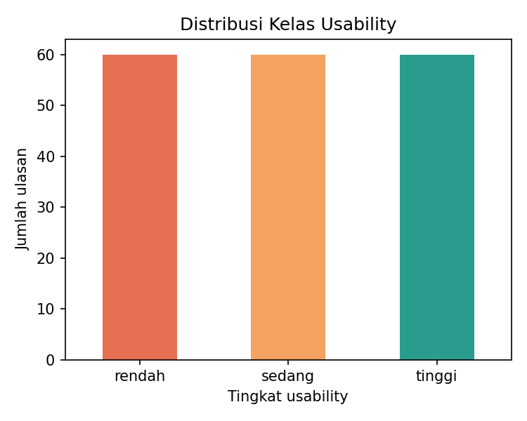
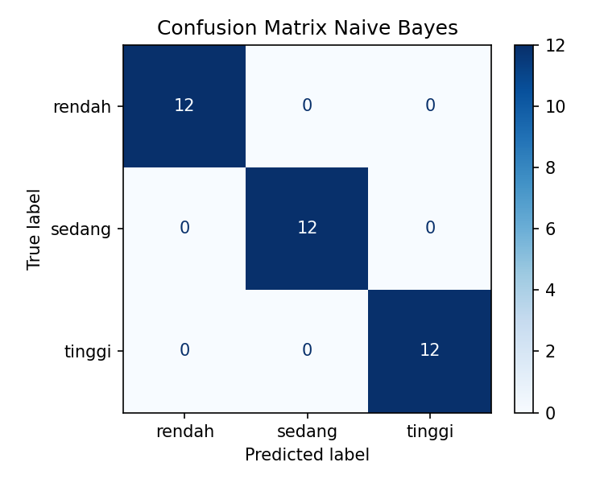

<div align="center">

# 🧭 Klasifikasi Tingkat Usability Aplikasi
### Penerapan Algoritma Naïve Bayes pada Teks Evaluasi Pengguna


*Studi kasus Sesi 5 — Human–Computer Interaction and Data Visualization*

</div>

---

## 📑 Daftar Isi
1. [Latar Belakang](#-latar-belakang)
2. [Studi Kasus](#-studi-kasus)
3. [Rumusan dan Tujuan](#-rumusan-dan-tujuan)
4. [Batasan Masalah](#-batasan-masalah)
5. [Keterkaitan dengan Materi Sesi 5](#-keterkaitan-dengan-materi-sesi-5)
6. [Dataset](#-dataset)
7. [Metodologi](#-metodologi)
8. [Struktur Proyek](#-struktur-proyek)
9. [Cara Menjalankan](#-cara-menjalankan)
10. [Hasil](#-hasil)
11. [Keterbatasan dan Catatan Penting](#-keterbatasan-dan-catatan-penting)
12. [Pengembangan Selanjutnya](#-pengembangan-selanjutnya)
13. [Unggah ke GitHub](#-unggah-ke-github)

---

## 🎯 Latar Belakang

Interaksi Manusia dan Komputer (IMK) bertujuan menciptakan sistem yang mudah dipahami, nyaman digunakan, dan sesuai kebutuhan pengguna. Untuk mengetahui apakah tujuan itu tercapai, antarmuka perlu dievaluasi, salah satunya lewat *usability testing* dan umpan balik pengguna.

Umpan balik biasanya berupa **teks bebas**: ulasan, komentar, atau jawaban kuesioner terbuka. Membaca ratusan komentar secara manual memakan waktu dan bersifat subjektif. Klasifikasi teks dengan *Machine Learning* dapat memetakan tanggapan pengguna mengenai kesan antarmuka ke dalam kategori tertentu secara otomatis dan konsisten.

## 📌 Studi Kasus

> **Judul:** Penerapan Algoritma Naïve Bayes untuk Mengklasifikasikan Tingkat Usability Aplikasi Berdasarkan Teks Evaluasi Pengguna.

Sebuah tim pengembang aplikasi mengumpulkan ulasan pengguna tentang kesan antarmuka. Setiap ulasan dikelompokkan ke dalam tiga tingkat usability:

| Kelas | Makna | Contoh ulasan |
|---|---|---|
| 🟢 **tinggi** | Mudah dipahami, nyaman, tugas selesai tanpa kendala | "menu mudah ditemukan dan tampilan rapi, saya puas memakainya" |
| 🟡 **sedang** | Dapat dipakai, tetapi ada hambatan kecil | "aplikasi kadang lambat tapi masih bisa dipakai dengan baik" |
| 🔴 **rendah** | Membingungkan, sulit dipakai, pengguna kecewa | "tampilan berantakan, saya sering salah menekan tombol dan kecewa" |

Hasil klasifikasi membantu tim menentukan prioritas perbaikan antarmuka.

## 🧪 Rumusan dan Tujuan

**Rumusan masalah**
1. Bagaimana mengubah teks evaluasi pengguna menjadi fitur numerik yang dapat diproses algoritma?
2. Seberapa baik Naïve Bayes mengklasifikasikan tingkat usability dari teks tersebut?

**Tujuan**
1. Membangun alur pemrosesan teks: pembersihan, pembobotan TF-IDF, dan klasifikasi.
2. Mengukur kinerja model dengan akurasi, precision, recall, F1-score, dan *confusion matrix*.
3. Menyajikan hasil dalam bentuk visual yang mudah dibaca.

## 🚧 Batasan Masalah

1. Data berbahasa Indonesia dan berupa kalimat ulasan singkat.
2. Klasifikasi tiga kelas: **rendah**, **sedang**, **tinggi**.
3. Algoritma yang dipakai hanya **Multinomial Naïve Bayes**; tidak ada perbandingan dengan algoritma lain.
4. Representasi teks memakai **TF-IDF** (unigram dan bigram).
5. *Preprocessing* terbatas pada *case folding*, penghapusan tanda baca dan angka, serta penghapusan *stopword*. Tidak ada *stemming*.
6. Dataset bersifat **sintetis** (dibuat untuk demonstrasi), bukan ulasan nyata dari toko aplikasi.
7. Pelabelan mengikuti pola kata pada data, bukan hasil penilaian pakar IMK.
8. Evaluasi memakai satu kali pembagian data latih dan uji (80:20), tanpa *cross-validation*.

## 🔗 Keterkaitan dengan Materi Sesi 5

| Konsep materi | Penerapan di proyek ini |
|---|---|
| *User-Centered Design* | Ulasan pengguna menjadi sumber data untuk perbaikan desain berulang |
| *Usability testing* dan *heuristic evaluation* | Dasar penentuan kategori tingkat usability |
| *User persona* dan analisis kebutuhan | Kata-kata pada ulasan mencerminkan kebutuhan dan masalah pengguna |
| Aksesibilitas dan kognitif | Keluhan seperti "teks sulit dibaca" dan "tombol terlalu kecil" muncul sebagai ciri kelas rendah |
| Visualisasi data | *Bar chart* untuk perbandingan kategori dan *confusion matrix* untuk hasil evaluasi |

## 🗂️ Dataset

- Berkas: `data/ulasan_usability.csv`
- Jumlah: **180 ulasan** (60 per kelas, seimbang)
- Kolom: `ulasan` (teks) dan `tingkat_usability` (label)

## ⚙️ Metodologi

```
Teks ulasan → Pembersihan → TF-IDF → Naïve Bayes → Evaluasi → Visualisasi
```

1. **Pembersihan teks**: huruf kecil, hapus tanda baca dan angka, hapus *stopword*.
2. **Pembagian data**: 80% latih dan 20% uji, dengan `stratify` agar proporsi kelas terjaga.
3. **Ekstraksi fitur**: `TfidfVectorizer` dengan unigram dan bigram.
4. **Pelatihan**: `MultinomialNB` (alpha = 1.0).
5. **Evaluasi**: akurasi, laporan klasifikasi, dan *confusion matrix*.
6. **Prediksi**: tiga contoh ulasan baru ditampilkan di akhir proses.

Naïve Bayes menghitung peluang kelas berdasarkan kata-kata dalam ulasan, dengan asumsi setiap kata saling bebas:

```
P(kelas | kata) ∝ P(kelas) × Π P(kata | kelas)
```

## 📁 Struktur Proyek

```
usability-naive-bayes/
├── data/
│   └── ulasan_usability.csv
├── src/
│   └── main.py
├── hasil/
│   ├── distribusi_kelas.png
│   └── confusion_matrix.png
├── requirements.txt
├── .gitignore
└── README.md
```

## ▶️ Cara Menjalankan

```bash
pip install -r requirements.txt
python src/main.py
```

Grafik tersimpan otomatis di folder `hasil/`.

## 📊 Hasil

| Distribusi kelas | Confusion matrix |
|:---:|:---:|
|  |  |

Pada data uji (36 ulasan), model mencapai akurasi **100%** dan seluruh contoh ulasan baru terklasifikasi sesuai harapan.

## ⚠️ Keterbatasan dan Catatan Penting

Akurasi 100% **tidak boleh dianggap kinerja nyata**. Dataset dibuat dari pola frasa yang berulang dan tiap kelas memiliki kosakata yang berbeda jelas, sehingga tugasnya sangat mudah bagi model. Pada ulasan nyata, bahasa lebih beragam, bercampur slang, singkatan, dan sarkasme, sehingga akurasi akan lebih rendah. Proyek ini dimaksudkan sebagai kerangka alur kerja yang siap diganti dengan data sebenarnya.

## 🚀 Pengembangan Selanjutnya

- Mengganti dataset dengan ulasan nyata (misalnya hasil kuesioner usability atau ulasan Play Store) yang dilabeli oleh lebih dari satu orang.
- Menambahkan *stemming* bahasa Indonesia, misalnya dengan Sastrawi.
- Menguji dengan *cross-validation* dan membandingkan dengan SVM atau Logistic Regression.
- Membuat dasbor interaktif sederhana (misalnya Streamlit) sesuai prinsip ringkasan dulu, detail kemudian.